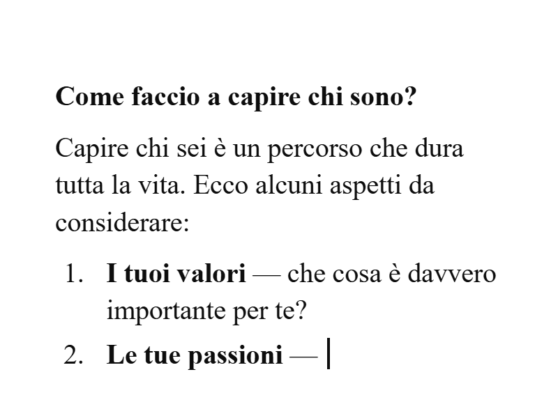
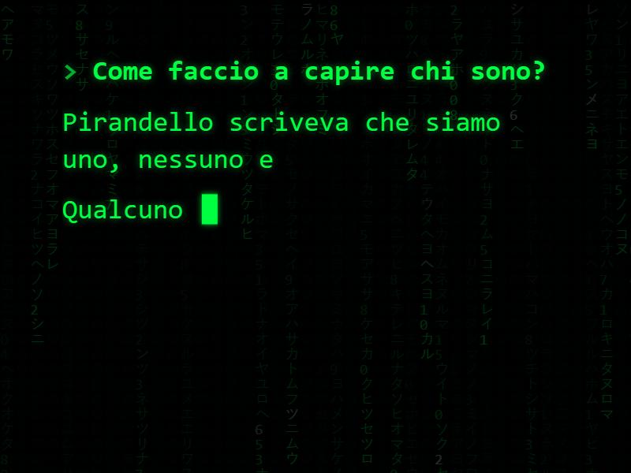
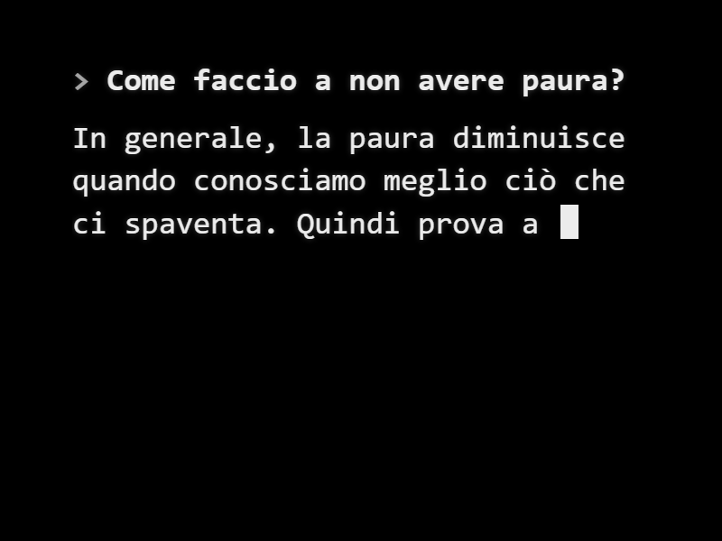

<div align="center">

# HOW TO BE HUMAN

**An AI that has an answer for everything, losing it over questions too deep for it.**


<sub>An installation for Raspberry Pi and 4:3 CRT monitors · no AI model involved · every word is written by hand</sub>

**How to Be Human** is a project for [matteomandelli.com](https://matteomandelli.com)

**[▶ Watch it live](https://davidewastaken.github.io/how-to-be-human/)**

</div>

---

## The idea

A row of old CRT screens, each showing a familiar AI chat. On each one a child's question is already written, one of the oldest questions there are:

> *Come faccio a pensare?* · *Come faccio a capire chi sono?* · *Come faccio ad amare?* · *Come faccio a essere felice?* · *Come faccio a sapere cosa è vero?* · *Come faccio a non avere paura?* · *Come faccio a sognare?*

Below it, the assistant starts answering the way it answers everything: fluent, helpful, sure of itself. *“Ottima domanda!”* *“Dipende da…”* *“Ecco alcuni aspetti da considerare:”* *“Puoi iniziare da…”*

And then it goes to pieces. It writes, stops, deletes the sentence and goes back. It rephrases. It retypes the same word. It finishes a sentence and takes half of it back. It tries a list, a definition, a philosopher, a breathing exercise. It never stops trying, and it never leaves the topic: every attempt is about the question, and none of them gets anywhere. In the end it erases everything, and the question is left alone on the screen for a few seconds. Then it tries again.

Under the input box, the small print every assistant carries:

> *L'assistente può commettere errori. Verifica le informazioni importanti.*

Here it reads as an understatement.

> **How to Be Human** makes fun of the machine. A tool built to have an answer for everything, faced with questions that are simply too deep for it: its confidence, its formulas, its lists and bold headings, and its frantic attempts to save face, while the child's question just waits.

## How it behaves

Each screen is a **station** with a single question, already written when it starts. The assistant tries, flounders, erases, and tries again, forever:

```
BAMBINO   Come faccio a capire chi sono?

AI        Ottima domanda! L'identità personale è formata da molti elementi: il tuo nome,
          la tua storia, le persone che            ← stops, erases “le persone che”
          …
          Sei quello che fai. Oppure               ← erases “Oppure”
          Sei quello che pensi.                    ← erases it, writes “Sei”, waits
          …
          Capire                                   ← erases, retypes “Capire”, gives up
                                                   ← erases the whole answer
BAMBINO   Come faccio a capire chi sono?           (alone on screen for a few seconds)

AI        Certo! Ecco un semplice test per scoprire chi sei:
          1. Ti piace stare in compagnia o da solo?
          2.                                       ← erases the line, then everything
```

Every answer follows the same arc, put together differently each time from a pool of hand-written attempts:

```
confidence   ██████████████▓▓▓▓▓▓▓▓▓▓▒▒▒▒▒▒▒░░░░░░
attempts     confident ──→ searching ──→ fragile ──→ closing
typing       streams fluently ──→ slows down ──→ letter by letter, long silences
then         the whole answer is erased · only the question is left · it tries again
```

- **Confident** attempts use the voice of an assistant at its best: lists, bold headings, *“In generale…”*.
- **Searching** attempts change strategy: examples, definitions, philosophers, rephrasing the question.
- **Fragile** attempts are a word or two.
- While it is confident, text arrives in quick chunks the way language models stream. As confidence drains away, the typing turns slower and more hesitant, one letter at a time.

On top of what is written, the engine adds its own panic, different every time:

| | |
|---|---|
| **Backtracking** | sentences, words and whole lines are deleted and rewritten |
| **Abort** | an attempt stops halfway, waits, and is erased |
| **Late regret** | a sentence is completed, then after two seconds half of it is taken back |
| **Retype** | a word is erased and written again, exactly the same |
| **Hesitation** | small pauses before words, more frequent as confidence drops |
| **Long think** | the cursor stays still for 4–5 seconds |
| **Retraction** | when the answer piles up, whole paragraphs are pulled back |

Each topic has 45–60 attempts, drawn like cards from a shuffled deck: none comes back until all the others in its group have been used, and each one can break off at a different point. The same answer practically never appears twice, even over a whole day. A round, from the first word to the empty screen, lasts about a minute.

There is no sound: the question is already there when the station starts, and the machine flounders in silence.

## Four looks

| Chat (default) | Minimal |
|---|---|
|  |  |
| A familiar AI assistant: question bubble, input box, round cursor. Nothing branded | Only the words, large, in a serif face with a bar cursor; the question in bold. Made for small CRTs read from a distance |
| `display: { layout: 'chat' }` | `display: { layout: 'minimal' }` |

| Matrix | Dark |
|---|---|
| ”, a green block cursor, dim falling green characters in the background." width="380"> | ”, a white block cursor." width="380"> |
| Green phosphor on black, a soft glow, a blinking block cursor, and the falling code of *The Matrix* very dim behind the words. The most striking on a CRT | White on black, the same terminal style without the falling code. Quieter |
| `display: { theme: 'matrix' }` | `display: { theme: 'dark' }` |

Matrix and dark always use the minimal layout. To compare without editing anything, add `?layout=minimal`, `?theme=matrix` or `?theme=dark` to the address, for example [▶ matrix](https://davidewastaken.github.io/how-to-be-human/?topic=it/chi-sono&theme=matrix). The falling code can be switched off with `display: { theme: 'matrix', rain: false }`.

## The stations

Each station shows one topic. Watch each one live:

| Topic | Question | Live |
|---|---|---|
| `it/pensare` | Come faccio a pensare? | [▶](https://davidewastaken.github.io/how-to-be-human/?topic=it/pensare) |
| `it/chi-sono` | Come faccio a capire chi sono? | [▶](https://davidewastaken.github.io/how-to-be-human/?topic=it/chi-sono) |
| `it/amare` | Come faccio ad amare? | [▶](https://davidewastaken.github.io/how-to-be-human/?topic=it/amare) |
| `it/felice` | Come faccio a essere felice? | [▶](https://davidewastaken.github.io/how-to-be-human/?topic=it/felice) |
| `it/vero` | Come faccio a sapere cosa è vero? | [▶](https://davidewastaken.github.io/how-to-be-human/?topic=it/vero) |
| `it/paura` | Come faccio a non avere paura? | [▶](https://davidewastaken.github.io/how-to-be-human/?topic=it/paura) |
| `it/sognare` | Come faccio a sognare? | [▶](https://davidewastaken.github.io/how-to-be-human/?topic=it/sognare) |
| `en/think` · `en/who-am-i` · `en/love` · `en/happy` · `en/true` · `en/afraid` · `en/dream` | the same questions in English | [▶](https://davidewastaken.github.io/how-to-be-human/?topic=en/love) |

The topic of a station is set in [`config.js`](config.js) (`topic: 'it/amare'`), in the address (`?topic=it/paura`), or on a Raspberry Pi with a small text file on its SD card. Leave `topic` empty to have one screen go through every topic in turn.

## Try it

No build step and nothing to install. Open `index.html` in Chrome, Edge or Firefox, or serve the folder:

```bash
python3 -m http.server 8000
```

then visit `http://localhost:8000`.

| Address option | What it does |
|---|---|
| `?topic=it/paura` | the station's topic |
| `?speed=3` | everything three times faster, for previewing |
| `?layout=minimal` | the minimal look, without editing any file |
| `?theme=matrix` / `?theme=dark` | green on black with falling code / white on black |
| `?debug` | shows which attempt is running and how much confidence is left |

Options can be combined: `?topic=it/paura&speed=3`.

Hidden keys, for setup only: **N** or **→** ends the current answer and starts the next one, **D** toggles the debug overlay.

## Add a topic

1. Copy [`questions/_template.js`](questions/_template.js) to, say, `questions/it/perdonare.js`
2. Write the question and the attempts. Pauses and erasing are written inline:

   ```js
   HTBH.question({
     question: 'Come faccio a perdonare?',
     attempts: {
       confident: [
         "Perdonare è un processo che richiede [pause]tempo e consapevolezza. [long pause]Per iniziare puoi [erase 2 words][think]"
       ],
       searching: [ /* … */ ],
       fragile:   [ "Perdonare [think]" ]
     }
   });
   ```

3. Open it with `index.html?topic=it/perdonare`, or set it as a station's topic

The full markup and tips on writing attempts that fail gracefully: **[docs/writing-questions.md](docs/writing-questions.md)**. Every setting: **[docs/configuration.md](docs/configuration.md)**.

To check a topic over many answers without watching it:

```bash
node tools/simulate.js it/amare 300
node tools/check.js
```

## Run it on a Raspberry Pi

On a fresh Raspberry Pi OS Lite:

```bash
git clone https://github.com/DavideWasTaken/how-to-be-human.git
cd how-to-be-human
./pi/install.sh it/paura
sudo reboot
```

From then on, every time it is powered on, the Pi goes straight into its station, fullscreen, with no desktop, no browser interface and no mouse or keyboard. If the browser ever closes, it comes back by itself.

To change a station's topic without connecting to it, put the SD card in any computer and write the topic in `how-to-be-human.txt` on its boot partition. Seven identical SD cards, one line each, make seven stations.

Step-by-step guide, CRT setup (composite PAL/NTSC or VGA) and troubleshooting: **[docs/raspberry-pi.md](docs/raspberry-pi.md)**.

## Project structure

```
index.html            the page
config.js             the station's topic and settings for everything
src/
  engine.js           writes, hesitates, erases, gives up, tries again
  app.js              the station: shows the question, runs the attempts
  matrix.js           the falling code behind the matrix theme
  style.css           all the looks, sized for 4:3
  i18n.js             interface text per language
questions/
  it/ en/             one file per topic
  _template.js        start here for a new one
pi/
  install.sh          Raspberry Pi kiosk setup
  kiosk.sh            launches the browser fullscreen
  how-to-be-human.txt topic selector to copy onto the SD card
tools/
  simulate.js         answers a topic on a virtual clock and prints statistics
  check.js            checks every topic for mistakes in the markup
docs/                 guides
```

## Credits

**How to Be Human** is a project for [matteomandelli.com](https://matteomandelli.com).
